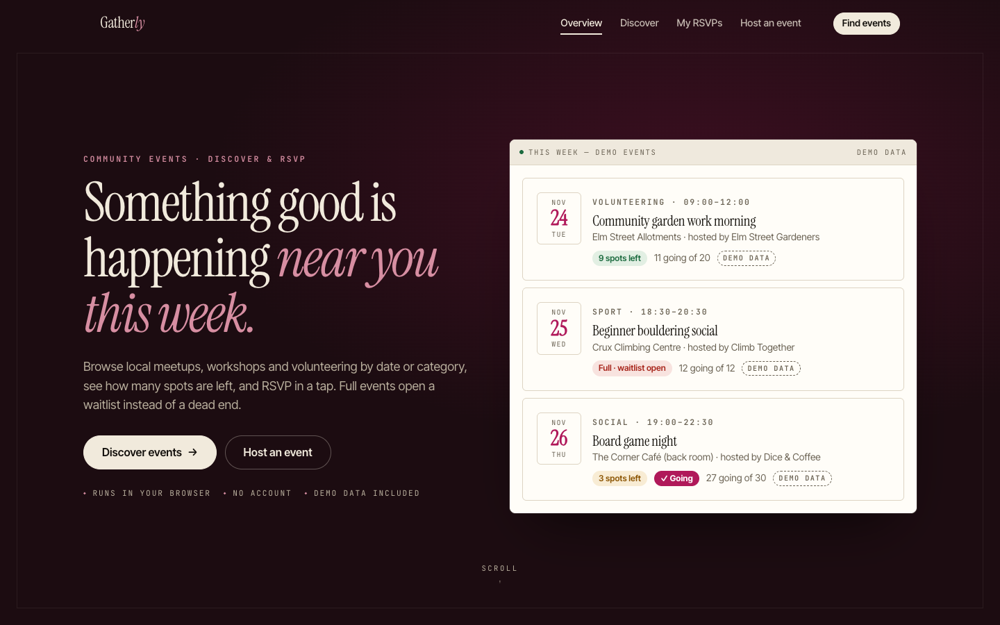
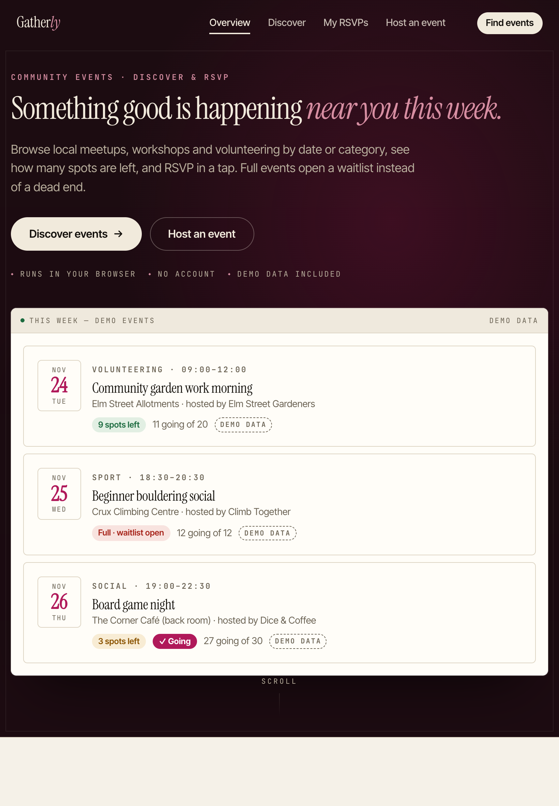
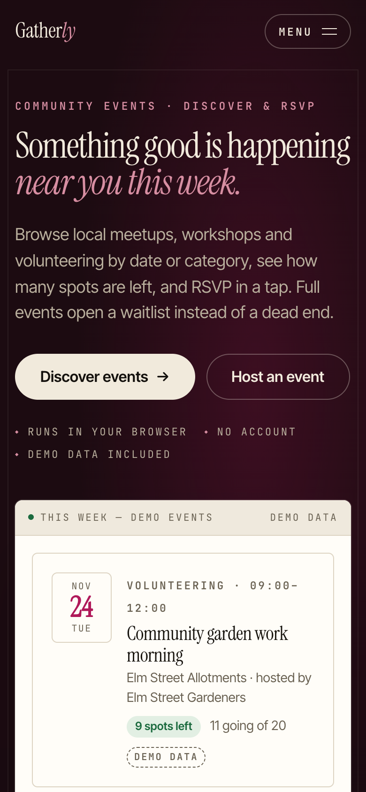
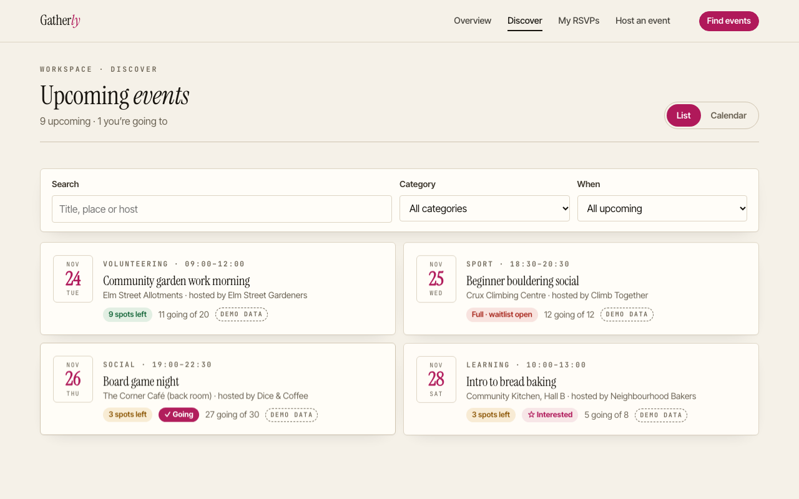
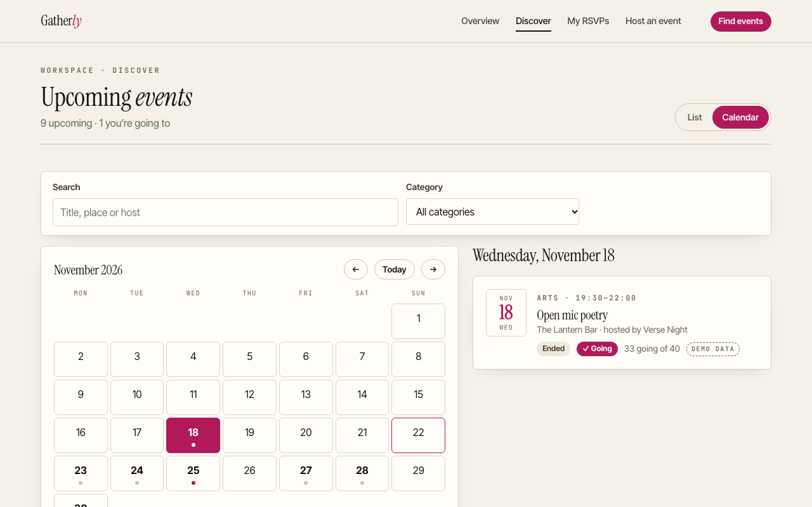
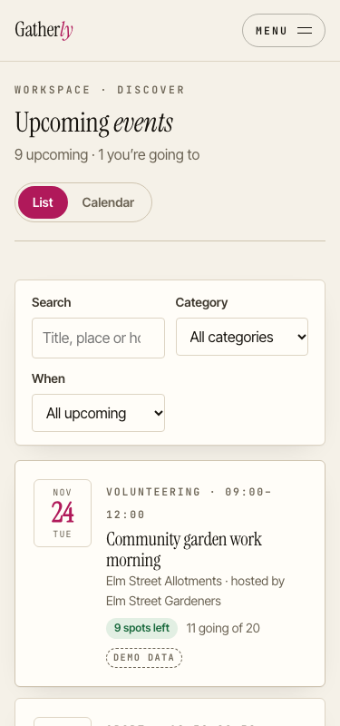

# Gatherly

<!-- screenshots:start -->
<p align="center">
  
</p>
<p align="center">
  
  &nbsp;&nbsp;
  
</p>
<p align="center"><sub>Mac (1440×900) · Tablet (820×1180) · Phone (390×844)</sub></p>
<!-- screenshots:end -->

Discover community events in a list or a month calendar, filter by category and date, RSVP as going or interested (or join a waitlist when full), and host your own events.

**Live demo:** [https://kavishtolani.github.io/gatherly/](https://kavishtolani.github.io/gatherly/) — runs entirely in your browser; demo data is fictional and labelled.



| Calendar view | Mobile |
| --- | --- |
|  |  |

## Run it

```bash
npm install
npm run dev        # http://localhost:5110
npm test
npm run build
npm run test:e2e   # Playwright smoke test (npm run e2e:install once if Chromium is missing)
```

## Main workflow

1. **Discover** opens with ten labelled demo events generated around today (one full, one already ended, two with unlimited capacity, one very long title). Filter by search, category and “When” (next 7 days, next 31 days, all upcoming, past).
2. Toggle **List / Calendar**. The calendar is Monday-first with dots per event (accent dot = you’re going); select a day to list its events.
3. Open an event → capacity bar, spots left, and RSVP buttons. **I’m going** on a full event becomes **Join waitlist**; ended events refuse RSVPs with a message.
4. **My RSVPs** groups upcoming and past plans.
5. **Host an event** → validated form (no past dates, end after start, capacity 1–10,000 or unlimited). You are automatically listed as going.

## Tests

- `src/lib/events.test.ts` — spots left, availability (open / few / full / past), RSVP transitions incl. waitlist and ended events, range/category/text filtering, month grid, validation.
- `src/App.test.tsx` — demo list + filters + past events, going and waitlist RSVPs, hosting with validation, empty RSVP state.
- `e2e/smoke.spec.ts` — list → calendar → day selection → RSVP → reload → My RSVPs; strict 375px checks.

## Limitations

- Local only: no accounts, invitations, notifications or shared event feed.
- Waitlisted people are not promoted automatically when a spot frees up.
- Events cannot be edited or cancelled after publishing.

## Future improvements

- Automatic waitlist promotion, editing/cancelling hosted events, ICS export per event.

## Licence

MIT — see [LICENSE](LICENSE).
